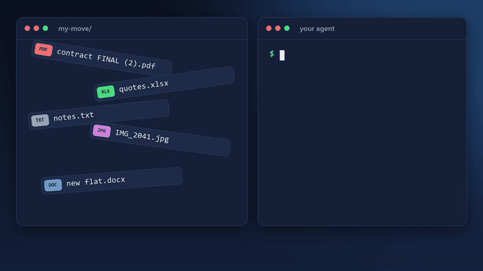

<div align="center">


# coldstart

**Get any folder ready for AI agents, once.**<br>
The next agent picks up where the last one stopped, on any machine.

[](https://github.com/thomasog/coldstart/actions/workflows/ci.yml)
[](https://github.com/thomasog/coldstart/releases/latest)
[](LICENSE)



<sub>An illustration of a typical run, not a screen recording.</sub>

</div>

## Why

- **No lock-in.** Your instructions and memory don't belong to one agent. Switch agents and keep working.
- **It all lives in the folder.** Nothing important is trapped in an account or in an app's hidden data.
- **It travels.** Copy, sync or zip the folder, and the context goes with it.
- **It lasts.** Plain text you can still read years from now, with no special tool.

## What it does

Run coldstart in a code repo or in a personal project such as a move, a trip or paperwork. It lists the folder, asks a few questions, writes the files below, and stops. It doesn't open your documents or start the project's work; that belongs to the next session.

```
<project>/
├── AGENTS.md              # instructions any agent can read
├── .ai/
│   ├── HANDOFF.md         # where we stopped and what comes next
│   └── memory/
│       └── MEMORY.md      # durable facts
├── .gitignore             # only if the folder is or will be in git
└── .claude/               # only if you use Claude Code
    ├── CLAUDE.md          # imports AGENTS.md, the handoff and the memory
    ├── settings.json      # keeps plans and memory inside the folder
    └── agents/            # only if you want model routing
        ├── scout.md       # cheap bulk reading, search and images
        └── worker.md      # mechanical work that is fully specified
```

Later, agents keep what they make for themselves in `.ai/` too: plans, reusable scripts, archives and scratch work.

The habit that makes it work: agents read `.ai/HANDOFF.md` at the start of a session and rewrite it at the end.

## Model routing (optional)

During setup coldstart asks once whether you want model routing. The default is no, and then nothing below is written.

If you say yes, the project gets three helpers, as config files and not as instructions:

- **`scout`:** bulk reading, search and images on the cheapest model.
- **`worker`:** mechanical work that is fully specified, on a mid-priced model.
- **`advisor`:** a second opinion from a stronger model when the agent is stuck.

What is written depends on the agents you named:

- **Claude Code:** two files in `.claude/agents/`, and `advisorModel` in `.claude/settings.json`, which turns on Claude Code's built-in advisor for everyone who opens the folder. The advisor uses more of your plan.
- **Codex, Gemini CLI, Cursor, Copilot:** the agent opens that tool's official documentation page, writes the same three helpers in its format with its current models, and shows them to you before writing. This path has no automatic test yet. Codex uses the helpers only when you ask for them by name.

Say no if you already route models in your own config.

## Works with

| Agent | Status |
|---|---|
| Claude Code | Tested |
| Codex | Tested |
| Cursor, Copilot, Antigravity | Read `AGENTS.md` according to their documentation; not yet run |

## Install

Read `SKILL.md` and `scripts/` before installing, as with any skill. Then paste this into your agent:

```text
Install the agent skill in plugin/skills/coldstart from https://github.com/thomasog/coldstart, then tell me how to run it.
```

Or use a command:

```bash
npx skills add thomasog/coldstart
```

```bash
gh skill install thomasog/coldstart coldstart --agent codex --scope user
```

**Claude Code plugin:**

```bash
claude plugin marketplace add thomasog/coldstart
```

```bash
claude plugin install coldstart@thomasog-plugins
```

Update it with `claude plugin update coldstart@thomasog-plugins`.

**By hand:** copy `plugin/skills/coldstart/` to `~/.claude/skills/` for Claude Code, `~/.gemini/config/skills/` for Antigravity, or `~/.agents/skills/` for Codex, Cursor, Copilot and Gemini CLI.

Python 3.9 or later makes the setup faster, and git is optional. Without Python, the agent does the same steps by hand.

## Use

Ask for it by name: `/coldstart` in Claude Code, `$coldstart` in Codex, or "run coldstart" anywhere. It never starts on its own. In a folder that is already set up, it only checks the files and stops.

Start your agent from the folder itself, not a subfolder: without git, Codex finds `AGENTS.md` only there, and Claude Code asks before loading the adapter's imports from a subfolder.

## What it reads, writes and runs

- **Reads:** file names, agent instruction and config files such as `CLAUDE.md` or `.mcp.json`, and build manifests such as `package.json`. It opens no other file, and it only checks whether a parent folder is a git repository.
- **Writes:** the files above, and nothing else. It moves `AGENTS.override.md`, and with Claude Code an old root `CLAUDE.md`, to `.ai/archive/` instead of deleting them, and shows you any command, URL, install step, hook or MCP server in old instructions first.
- **Runs:** `coldstart.py`, a short Python script that uses only the standard library, launches no other program, makes no network calls and asks no questions. The agent runs `git init` if you ask for git.
- **Changes in Claude Code:** `.claude/settings.json` turns off auto memory for that folder, keeps plans in `.ai/plans/`, and denies Claude's own Read and Edit tools access to `.env` files. Anything Claude had already saved for the folder stays in `~/.claude` and is no longer loaded there; copy what you want by hand. Folders set up before 1.3.0 can delete `.claude/agents/advisor.md`; Claude Code's built-in advisor replaces it.
- **With model routing:** the files described under Model routing. For agents other than Claude Code, the agent also opens one official documentation page per agent on the web.

There are no hooks and no telemetry.

## Why not something else?

- **`/init`** writes an instruction file for a code repo. It doesn't set up a handoff or memory, and it isn't meant for personal folders.
- **Cowork Projects** are a good fit if you stay in Cowork. Their instructions and memory stay in the desktop app on one computer, not in the folder.
- **project-butler and project-continuity** give coding agents an ongoing memory workflow. coldstart runs once, works outside code too, and leaves plain files with nothing else to keep running.

## Evidence

The [`evals/`](evals/) folder holds fictional cases for `claude plugin eval`, including a folder with a deadline in a filename and one with hostile old instructions. They need Linux, macOS or WSL2 and use your plan or API credits. Results per release are in the [changelog](CHANGELOG.md).

```bash
claude plugin eval . --scaffold --ablation none --allow-tools Bash Write Edit
```

`python -m unittest discover -s tests` runs the script's tests. The reasoning behind each choice is in [`rationale.md`](plugin/skills/coldstart/references/rationale.md).

## License

[MIT](LICENSE)
